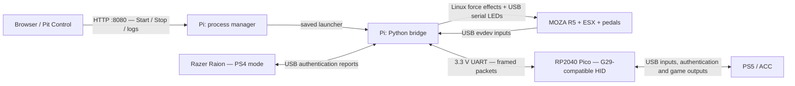
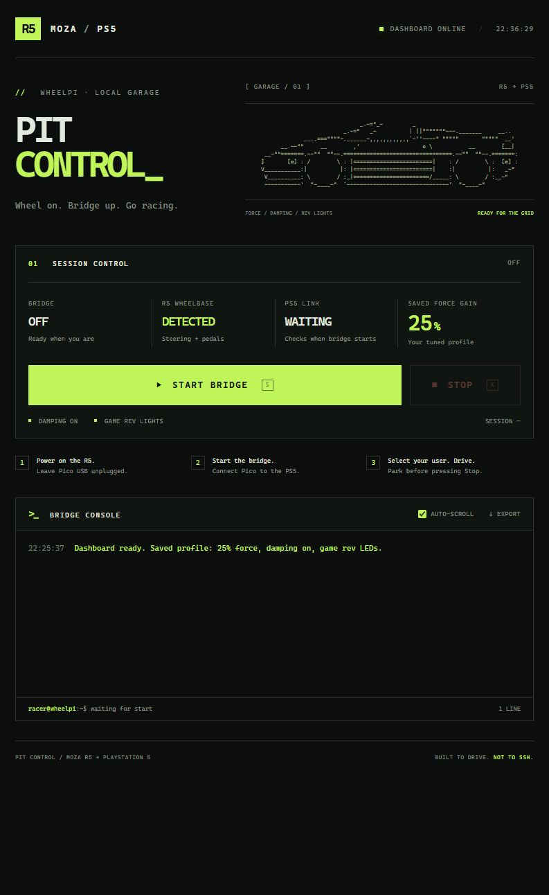

# MOZA R5 → PS5 adapter

An experimental adapter for using a **MOZA R5 wheelbase, ESX wheel and SR-P Lite pedals** in **Assetto Corsa Competizione on PS5**, with steering, pedals, buttons, force feedback, damping and rev LEDs.

A Raspberry Pi hosts the wheel and an authentication donor. An original RP2040 Pico connects to the PS5 as a G29-compatible USB wheel. **Pit Control**, a browser dashboard on the Pi, starts and stops the bridge without an SSH session.

This is a working hobby prototype for the tested rig, not a universal wheel adapter or an official MOZA, Sony, Logitech or Razer product. A **Razer Raion in PS4 mode must remain connected**; the project does not include controller authentication keys.

[Hardware](#hardware-and-wiring) · [Setup](#setup) · [Daily use](#daily-use) · [Mappings](#changing-mappings-and-settings) · [Development](docs/LOCAL_DEVELOPMENT.md)

## What works

| Function | Current behavior |
| --- | --- |
| Console connection | G29-compatible USB profile; user selection and repeated donor authentication tested on PS5 |
| Inputs | Steering, throttle, brake, clutch, paddles, D-pad and mapped ESX buttons |
| Steering travel | Profile captured at **900° total**, ±450° from center |
| Force feedback | Supported G29 constant-force commands translated to Linux `FF_CONSTANT` |
| Damping | Supported G29 damper slots translated to Linux `FF_DAMPER`, enabled separately |
| Rev LEDs | Game-supplied five-bit shift-light mask drives the ESX bar, with progressive fill and shift-point blinking |
| Browser control | Start/Stop, device/link state, uptime, live console and recent-log export |

The preferred tested profile is **25% host gain**, damping enabled, with ACC gain **100%**, dynamic damping **100%**, minimum force **0%**. It was tuned in a Porsche 911 at Zandvoort. This is a reference for that rig, not a calibrated torque guarantee: 30% felt too heavy and produced a strong off-road jolt. The generic CLI defaults to **10%** and caps host gain at **30%**.

Force release was physically checked at 10% after Pico removal, normal shutdown, abrupt process termination and a frozen bridge. Precise physical expiry time and G29-to-R5 force equivalence have not been measured. Other bases, rims, pedal connections, games and console modes are unverified. Unsupported effect types are not implemented as full G29 passthrough.

## Hardware and wiring

| Component | Purpose / tested configuration |
| --- | --- |
| Raspberry Pi 4 | Raspberry Pi OS 64-bit; USB host, Python bridge and dashboard |
| Original Raspberry Pi Pico / Pico H | **RP2040**, board target `pico`; console-facing USB device. Pico W and Pico 2 are rejected by this build |
| Razer Raion | USB authentication donor, **PS4 mode**, USB identity `1532:1100` |
| MOZA R5 and power supply | USB identity `346e:0004`; wheel and pedals connect through the base |
| MOZA ESX wheel | Tested rim; do not assume another ES/ESX variant has identical buttons or LED behavior |
| SR-P Lite pedals + clutch | Throttle, brake and clutch connected to the R5 |
| PS5 + ACC | Tested console/game combination |
| Cables and power | Pi power supply and microSD, Pico micro-USB **data** cable, R5/Raion USB cables and three 3.3 V UART jumper wires |
| Browser on the same LAN | Phone or computer for Pit Control; development computer for flashing/builds |

Connect the R5 and Raion to the **Pi's USB ports** and the **Pico's micro-USB port to the PS5** during use. Cross the UART connections:

| Raspberry Pi 4 | Pico / Pico H |
| --- | --- |
| GPIO14, physical pin 8 — TX | GPIO1, physical pin 2 — RX |
| GPIO15, physical pin 10 — RX | GPIO0, physical pin 1 — TX |
| GND, e.g. physical pin 6 | GND, e.g. physical pin 3 |

Use **3.3 V logic**, a shared ground and **1,000,000 baud, 8N1**. Power the Pi from its own supply and the Pico from USB. Do not join the Pi's 5 V rail to the Pico or UART pins. Disconnect power/USB before changing wiring.

## Architecture



The **Pico** owns console USB behavior: descriptors, input reports, authentication pages, connection events and complete game-output forwarding. The **Pi** owns Linux device access, input calibration, donor signing and output translation. A separate output worker keeps wheel I/O away from the UART/authentication loop.

The UART protocol uses COBS framing, CRC32, session identifiers and authentication-generation tokens. Complete output reports also carry sequence numbers and device timestamps. Sampled diagnostic events never drive live force. Stale or invalid traffic invalidates output state; native force effects have finite **150 ms** lifetimes. The Pico neutralizes stale input after **200 ms**.

Pit Control manages the saved bridge command; it does not process steering or send torque itself. Closing the browser leaves the bridge running. Stopping the dashboard service requests bridge shutdown. See [the architecture guide](docs/ARCHITECTURE.md) for data flows, failure handling and source ownership.

## Setup

Run Linux commands below **on the Pi** unless noted otherwise. The systemd service expects the checkout at `~/moza-ps5-current`.

### 1. Install the host

Use Raspberry Pi OS 64-bit with Python 3.10 or newer; Python 3.13 was used on the tested Pi.

```sh
sudo apt update
sudo apt install -y git python3-venv python3-dev build-essential libusb-1.0-0-dev libudev-dev

git clone https://github.com/EvilCorpDev/moza-ps5-adapter.git ~/moza-ps5-current
cd ~/moza-ps5-current
python3 -m venv .venv
.venv/bin/python -m pip install -r host/requirements.txt
.venv/bin/python -m pip install -e host
```

Runtime dependencies are pinned in [`host/requirements.txt`](host/requirements.txt). The Python distribution retains the historical name `moza-ps5-diagnostics` and version `0.1.0`, separate from Pico firmware `0.3.1-outputs-experimental`. Identify host builds by source commit.

### 2. Configure UART and permissions

In `sudo raspi-config`, enable serial hardware and **disable the serial login shell**. For the tested Pi 4, use these entries under `[all]` in `/boot/firmware/config.txt` (older installations use `/boot/config.txt`):

```ini
enable_uart=1
dtoverlay=disable-bt
```

Remove any serial-login `console=serial0,...` argument from the existing single-line kernel command line. The overlay gives GPIO14/15 the PL011 UART and disables onboard Bluetooth. Reboot after configuration; `/dev/serial0` should exist.

The bridge runs as your normal Pi user. It needs access to the UART, R5 event/serial interfaces and Raion USB node:

```sh
sudo usermod -aG dialout,input,plugdev "$USER"
sudo sh tools/install_raion_access.sh
```

Log out/back in or reboot for group changes. The helper installs a [device-specific Raion rule](tools/70-moza-ps5-raion.rules); it does not change SSH or sudo permissions. Verify actual device permissions on your OS. Force effects require write access to the R5 event node; the dashboard should not run as root.

### 3. Build and flash the Pico

Build on a Linux development machine or the Pi with CMake, Ninja and an ARM bare-metal GCC toolchain installed. The tested toolchain is Arm GNU **13.2.Rel1**. Fetch Pico SDK 2.1.1 and its TinyUSB dependency:

```sh
cd ~/moza-ps5-current
git clone --branch 2.1.1 --depth 1 https://github.com/raspberrypi/pico-sdk.git third_party/pico-sdk
git -C third_party/pico-sdk submodule update --init --depth 1 lib/tinyusb
export PICO_SDK_PATH="$PWD/third_party/pico-sdk"

cmake -S firmware -B build-pico-v3-outputs -G Ninja \
  -DPICO_NO_PICOTOOL=1 -DMP_FIRMWARE_V3=ON -DMP_OUTPUT_STREAM=ON
cmake --build build-pico-v3-outputs
.venv/bin/python tools/bin_to_uf2.py \
  build-pico-v3-outputs/moza_ps5_diagnostic.bin \
  build-pico-v3-outputs/moza_ps5_diagnostic_v3-outputs.uf2
.venv/bin/python tools/verify_v3_firmware.py \
  --bin build-pico-v3-outputs/moza_ps5_diagnostic.bin \
  --uf2 build-pico-v3-outputs/moza_ps5_diagnostic_v3-outputs.uf2 \
  --version 0.3.1-outputs-experimental
```

Pinned commits: Pico SDK `bddd20f928ce76142793bef434d4f75f4af6e433`, TinyUSB `86ad6e56c1700e85f1c5678607a762cfe3aa2f47`. SDK sources, toolchains and firmware binaries are obtained/built locally rather than committed. [Windows commands and other build profiles](docs/LOCAL_DEVELOPMENT.md#pico-firmware).

To flash, unplug Pico, hold **BOOTSEL**, connect it to your computer, then copy the generated `.uf2` onto **RPI-RP2**. It reboots automatically. Normal firmware presents a HID wheel, not a USB serial console. Leave Pico USB disconnected from the PS5 until the bridge is running.

**Both `MP_FIRMWARE_V3=ON` and `MP_OUTPUT_STREAM=ON` are required for FFB/LEDs.** Baseline/v2 are earlier diagnostic experiments. Plain v3 supports inputs but does not stream complete game outputs.

### 4. Discover your device paths

With powered R5 and Raion connected to Pi USB, Raion in PS4 mode:

```sh
.venv/bin/python -m moza_ps5 doctor
.venv/bin/python -m moza_ps5 list-donors
.venv/bin/python -m moza_ps5 list-r5
ls -l /dev/input/by-id/
ls -l /dev/serial/by-id/
```

Record the Raion HID **path**, R5 joystick event path and R5 **if00** serial path. Prefer `/dev/input/by-id/...-if02-event-joystick` over a changing `/dev/input/eventN`. Wheel serial-number paths are specific to your device; the donor path can change when USB ports change.

### 5. Check authentication and inputs

Replace example paths with your discovered values:

```sh
.venv/bin/python -m moza_ps5 probe-raion --path 'RAION_HID_PATH'
.venv/bin/python -m moza_ps5 preview-r5 /dev/input/eventN
```

Preview sends no force/LED commands. Centered steering is about `32768`; full left/right should reach `0`/`65535`. Released pedals are `65535`, fully pressed pedals `0`—these are encoded report values, so they decrease as you press. Stop with Ctrl+C. [Adjust the map](docs/CONFIGURATION.md) if your calibration differs.

For an initial PS5 test with **inputs only**:

```sh
.venv/bin/python -u -m moza_ps5 bridge \
  --serial /dev/serial0 --donor-path 'RAION_HID_PATH' \
  --press-ps --r5-input /dev/input/eventN
```

Start the bridge, connect Pico to PS5, select your user, then enter ACC. Set ACC steering lock and Pit House rotation to the same **900°**. Stop with Ctrl+C before changing configuration.

### 6. Enable outputs and prepare the saved launcher

For a first output check, start at **10%**, keep hold of the wheel and make gentle turns:

```sh
.venv/bin/python -u -m moza_ps5 bridge \
  --serial /dev/serial0 --donor-path 'RAION_HID_PATH' \
  --press-ps --r5-input /dev/input/eventN \
  --ffb --ffb-gain 0.10 --ffb-damper \
  --r5-leds /dev/serial/by-id/YOUR_R5_IF00_PORT
```

The saved browser/terminal launcher selects **25%**, damping and LEDs. It currently records the original test rig's paths. **Edit its source template for your hardware before installing:**

```sh
nano tools/start_bridge_current.sh
# Replace --donor-path, --r5-input and --r5-leds with your discovered paths.
cp tools/start_bridge_current.sh start-bridge.sh
chmod +x start-bridge.sh
./start-bridge.sh --check
```

`--check` prints arguments without opening hardware. Keep the root-relative launcher location and shared `flock` lock intact. Set the `R5_INPUT` detection constant in [`dashboard/controller.py`](dashboard/controller.py) to your event path too. Dashboard labels describe the saved 25% profile; they do not automatically read the gain from the launcher.

### 7. Install Pit Control

```sh
bash deploy/install_dashboard.sh
```

The installer refreshes `start-bridge.sh` from the source template, preserves the first pre-install launcher backup, and refuses updates while the bridge owns the lock. It enables a user systemd service and lingering so the dashboard starts at boot without SSH login. If your OS requires authorization for lingering, run `sudo loginctl enable-linger "$USER"` once, then rerun the installer.

Find the Pi's address with `hostname -I` and open **`http://PI_LAN_IP:8080/`**. Only the dashboard starts at boot; wheel output waits for **Start Bridge**. See [dashboard maintenance](docs/WEB_DASHBOARD.md) for service commands, updates and logging.

## Daily use

1. Power on Pi, R5 and donor. Leave Pico USB unplugged from the PS5.
2. Open Pit Control and press **Start Bridge**.
3. Connect Pico to PS5 and select your user when prompted.
4. Enter ACC and confirm the **wheel is the active controller**, especially after using a gamepad in menus.
5. Drive. Park before pressing **Stop**, then unplug Pico if finished.

Keyboard shortcuts: **S** starts, **X** stops. Closing the browser leaves the session running. Terminal fallback: `cd ~/moza-ps5-current && ./start-bridge.sh`; Ctrl+C stops it. Saved browser/terminal starts share a lock. An external bridge is shown as **EXTERNAL** and must be stopped in its own terminal. Direct raw CLI launches bypass this launcher lock.

The dashboard uses Host/origin/token checks but has **no login or TLS**. Anyone who can reach its LAN interface can operate it. Keep it on a trusted local network; do not expose port 8080 to the internet. A Cloudflare Tunnel hostname needs an explicit HTTPS-origin allowlist and an authentication layer such as Access: [proxy setup](docs/WEB_DASHBOARD.md#https-hostname-through-cloudflare-tunnel).

<details>
<summary>Pit Control screenshot</summary>



</details>

## Changing mappings and settings

| Change | Where |
| --- | --- |
| Buttons, axis codes and pedal endpoints | [`host/moza_ps5/profiles/r5-esx-srp-lite.json`](host/moza_ps5/profiles/r5-esx-srp-lite.json), or copied JSON supplied with `--r5-map` |
| Discover physical input codes | `monitor-r5`, `preview-r5`, [`tools/capture_r5.py`](tools/capture_r5.py) |
| Device paths, force gain, optional outputs | Installed `start-bridge.sh`; keep [`tools/start_bridge_current.sh`](tools/start_bridge_current.sh) in sync for installer updates |
| Steering angle | Pit House and ACC; profile rotation metadata does not configure the base |
| Supported game output commands | [`host/moza_ps5/wheel_output.py`](host/moza_ps5/wheel_output.py) |
| Gain cap, polarity, Linux effect encoding | [`host/moza_ps5/linux_ffb.py`](host/moza_ps5/linux_ffb.py) |
| Output freshness and shared force budget | [`host/moza_ps5/output_worker.py`](host/moza_ps5/output_worker.py) |
| LED patterns and serial protocol | [`host/moza_ps5/moza_leds.py`](host/moza_ps5/moza_leds.py) |
| USB identity, endpoints and report layout | [`firmware/usb_descriptors.c`](firmware/usb_descriptors.c), [`usb_profile.h`](firmware/usb_profile.h), descriptor headers and `firmware/core/usb_reports.c`; rebuild/flash |
| Dashboard art/layout | [`dashboard/static/`](dashboard/static/); process handling in `dashboard/controller.py` |

[Configuration guide](docs/CONFIGURATION.md): full ESX mapping table, calibration fields, custom-map example and output options. Current LEDs follow a **shift-light mask, not engine RPM**. When the game sends zero there is no rev value to recover; earlier RPM-based fill would need another telemetry source or an approximate policy.

## Source layout

```text
firmware/                  RP2040 C firmware, USB profiles and portable tests
host/moza_ps5/             Python bridge, auth, inputs and output backends
host/moza_ps5/profiles/    JSON calibration and button maps
host/tests/               Regression tests and protocol fixtures
dashboard/                Python HTTP/process manager, HTML/CSS/JS and tests
deploy/                   User systemd service and installer
tools/                    Builds, verification, capture and diagnostic helpers
docs/                     Architecture, configuration and operating guides
third_party/              Dependency provenance and descriptor license
```

Chat exports, local handoffs, raw hardware logs, old packages, environments, research checkouts, SDK trees and build outputs are intentionally ignored. Application source, tests and selected fixtures are committed; dependencies are fetched at the pinned revisions. Local archives remain intact.

## Tests and development

Regression tests use simulated devices/subprocesses; they do not start the real bridge or send hardware force.

```sh
.venv/bin/python -m pip install -r host/requirements-dev.txt
.venv/bin/python -m pytest -q host/tests tools/tests dashboard/tests
PYTHON=.venv/bin/python sh tools/run_tests.sh
```

The final command also compiles/runs portable C tests for baseline, v2, v3 and v3-output profiles; it needs a native C compiler. Linux process tests skip on Windows. An optional raw-capture provenance check skips when private logs are absent; decoder, force-budget and lifecycle tests use committed fixtures. Some `tools/probe_*.py` helpers are physical experiments, distinct from the test suite—inspect them before running.

[Development guide](docs/LOCAL_DEVELOPMENT.md): Windows setup, toolchain paths, build profiles and verification limits.

## Troubleshooting

| Symptom | Check |
| --- | --- |
| No PS5 user chooser | v3-output firmware, USB data cable, Raion PS4 mode, correct HID path; start bridge before connecting Pico |
| Preview works but ACC inputs do not | User selection and wheel as active controller after gamepad menu input |
| Pedals miss endpoints | Capture your calibration; adjust `released`, `pressed`, deadzones; check pedal-to-base connections |
| R5 missing in dashboard | Its `R5_INPUT` detection path; device existence alone is not live input |
| Inputs but no FFB/LEDs | Output-stream firmware, explicit `--ffb` / `--r5-leds`, paths and permissions |
| LEDs dark until high revs | ACC may send a nonzero mask only near shifting; no absolute RPM is supplied |
| LEDs animate after Stop | Base may resume its own idle animation after LED control is released |
| Force pulls farther into turns | Stop and check polarity at low gain; `--ffb-invert` reverses the tested default |
| EXTERNAL / exit 75 | Another saved launcher holds `.bridge.lock`; stop that session first |
| Browser cannot connect | Pi LAN address and `systemctl --user status moza-ps5-dashboard.service` |
| Permission denied | Device modes, groups, fresh login and udev rule; avoid a second root bridge |

## License and references

Application code is [MIT licensed](LICENSE). Adapted GP2040-CE descriptor material retains its [upstream MIT notice](third_party/GP2040-CE-LICENSE). Pico SDK/TinyUSB retain their own licenses. See [third-party notices](third_party/NOTICE.md) and [protocol references](docs/PROTOCOL_REFERENCES.md).
